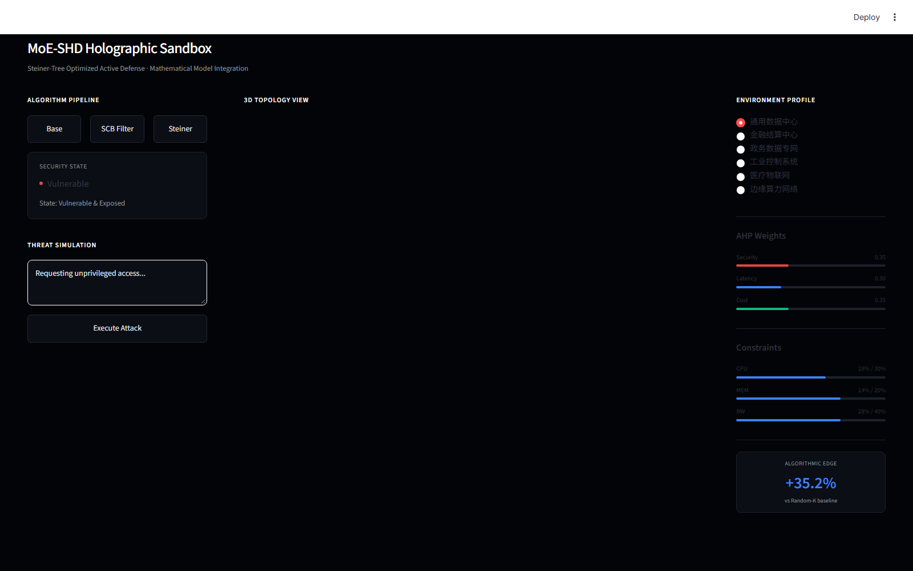
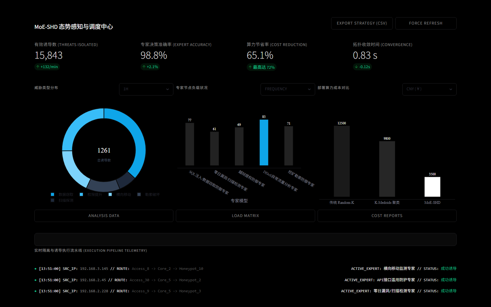
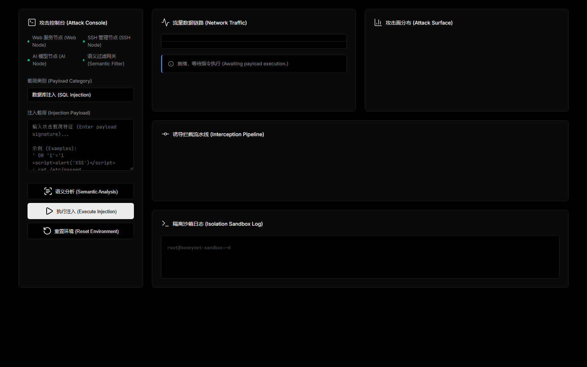

# Honeynet-AIGC

基于斯坦纳树的混合专家（MoE）大模型蜜罐统一优化部署系统。针对分布式 MoE 网络面临的门控探测、专家调取、提示注入、越权攻击等威胁，将核心资产抽象为终端节点、蜜罐位置抽象为斯坦纳节点，通过因子筛选、优化排序、斯坦纳树构建与遗传算法优化，设计"无感诱导 + 拓扑级协同欺骗"的主动防御体系。

## 核心特性

- **SCB 因子筛选**：从安全、成本、平衡三个维度对候选节点评分过滤，缩小求解空间。
- **OSE 优化排序**：基于度数中心性、介数中心性等多维指标，结合 TOPSIS 综合排序。
- **斯坦纳树构建**：构建连接终端节点的最小成本树，支持动态扰动与租户隔离。
- **遗传算法优化**：种群进化、精英保留，求解多目标约束下的最优蜜罐部署方案。
- **动态攻击模拟**：内置扫描、横向移动、提权、DDoS 等多种攻击行为仿真。
- **可视化平台**：Streamlit 前端 + FastAPI 微服务，提供 3D 攻防沙盘与态势指挥中心。

## 技术栈

| 层次 | 技术 |
|------|------|
| 核心算法 | Python、NetworkX、遗传算法、TOPSIS |
| 后端服务 | FastAPI、Uvicorn、Flask |
| 前端可视化 | Streamlit、ECharts / ECharts-GL |
| 数据与配置 | PyYAML、Pydantic |

## 目录结构

```
Honeynet-AIGC/
├── home.py                  # 登录入口（Streamlit）
├── _pages/                  # 前端页面：算法工作台、攻防沙箱、指挥中心
├── backend/                 # FastAPI 后端 API 服务
├── services/                # 安全网关与蜜罐虚假推理微服务
├── src/
│   ├── core/                # SCB / OSE / 斯坦纳树 / 遗传算法四大核心模块
│   ├── data_structures/      # 节点、边、攻击与配置数据结构
│   ├── evaluation/          # 评估器、帕累托分析、调度分析
│   ├── security/            # 动态攻击模拟器
│   └── comparison/          # 基准对比算法（随机 / K-Medoids / 贪心）
├── standalone_scripts/      # 独立实验与图表生成脚本
├── configs/                 # 场景与实验配置
├── charts/                  # 实验结果图表
├── static/                  # ECharts 静态资源
└── 说明/                    # 操作手册、功能模块阐述、依赖清单
```

## 快速开始

```bash
# 1. 安装依赖
pip install -r 说明/requirements.txt

# 2. 启动登录与主界面
streamlit run home.py
```

也可直接运行根目录下的 `一键启动（整体）.bat` 或 `一键启动（分页启动）.bat`，按顺序拉起后端服务与前端页面。

## 界面预览

**算法工作台（3D 攻防沙盘）**



**态势感知与调度中心**



**蜜罐攻击控制台**



## 算法流程

```
输入网络拓扑
      ↓
SCB 因子筛选 → OSE 优化排序 → 斯坦纳树构建 → 遗传算法优化
      ↓
输出最优蜜罐部署方案
```

## 实验结果

在最大 1804 节点（标称 2000）的 Spine-Leaf 拓扑下完成六组三维度实验：

- 部署成本较无种子方案平均降低 **28.0%**
- 请求加权系统延迟平均降低 **20.3%**
- 热点覆盖率达到 **0.972**
